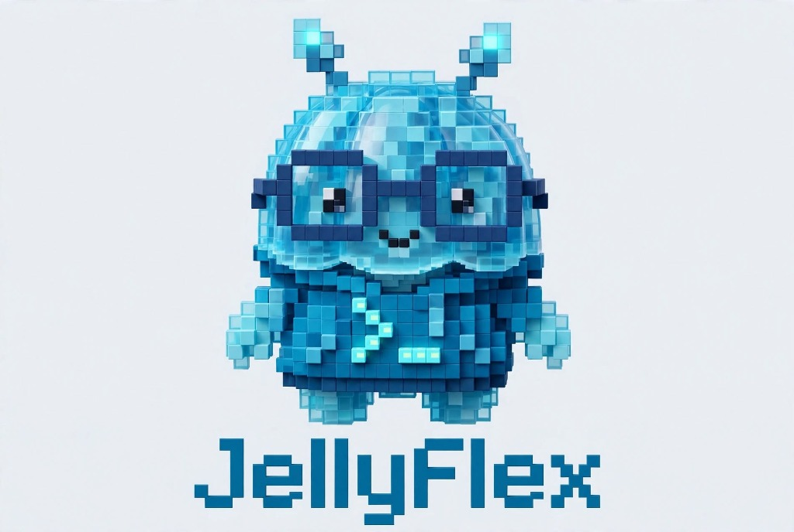

# JellyFlex 2.0 — Conversational Multi-Agent AI Suite & Social Engine

[](LICENSE)
[](https://agno.com)
[](https://antigravity.google)
[](electron/)
[](https://github.com/morluto/rea)

<p align="center">
  
</p>

> **JellyFlex 2.0** is an open-source, local-first, zero-knowledge conversational AI agent suite and social media automation engine. Completely free from cluttered dashboards, JellyFlex gives creators and developers an ultra-clean **conversational workspace** reverse-engineered from the best elements of **CUE by Manus**, **OpenClaw 2.0**, and **Claude Desktop**.
>
> Features **isolated 1-on-1 specialist agent chats** and **WhatsApp/Slack-style Multi-Agent Squad Group Chats** powered by **Agno OS 3.1** and the **Google Antigravity SDK**.

---

## 🔑 Single-Time GitHub Community Access Code

JellyFlex 2.0 is an invite-only open-source release with zero developer telemetry:

```text
Community Access Code: JELLYFLEX-COMMUNITY-2026
```

- **One-Time Only**: Enter this code on first launch. It is permanently verified in your local SQLite database (`backend/database/secure_state.db`) and local storage.
- **Never Prompts Again**: Subsequent launches automatically unlock straight into your conversation feed.

---

## 🔐 Strict Bring-Your-Own-Key (BYOK) Sovereignty

JellyFlex **never bundles developer API keys**. You maintain 100% cryptographic sovereignty over your models and tokens:
- **Supported Providers**: Google Gemini (Flash & Argon), OpenAI (GPT-4o), Anthropic Claude (Sonnet 3.5), xAI Grok, Instagram Graph API, and Local Ollama (100% free offline).
- **Zero-Knowledge Encryption**: Keys are encrypted at rest with hardware-bound `PBKDF2HMAC` (480,000 iterations) + `Fernet` AES-128-CBC. Keys are never exposed in plaintext over HTTP.

---

## 🤖 1-on-1 Specialist Agents & Multi-Agent Squads

Unlike bloated dashboards, JellyFlex is 100% conversational:

### 1. Distinct 1-on-1 Specialist Agents
Every agent has their own distinct author persona, system instructions, color theme, and **isolated SQLite memory**:
- **Scout (`agent-scout`)** — *Research & Outlier Scout* (Cyan): Mines 30-day viral trend outliers, audience sentiment, and competitor teardowns.
- **Aura (`agent-aura`)** — *Instagram & Visual Strategist* (Pink): Retention curves, 0-3s pattern interrupts, 10-slide carousel storyboarding, and IG SEO.
- **Volt (`agent-volt`)** — *Viral Hook & Copy Chief* (Amber): Sharp, high-CTR hooks, irresistible curiosity gaps, and shadowban avoidance.
- **Cipher (`agent-cipher`)** — *Code & Automation Engineer* (Indigo): Clean-room engineering, local API bridges, and autonomous scripts.
- **+ Create Custom Agent**: Configure custom name, role, persona, model, system instructions, avatar glyph, and color theme.

### 2. Multi-Agent Squads (WhatsApp / Slack Style)
Assemble multiple agents into a collaborative group chat:
- **Omni-Channel Launch Squad**: Scout, Volt, Aura, and Cipher collaborate in a unified real-time conversation stream.
- **Viral Research & Copy Team**: Fast turnaround trend analysis and copy synthesis.
- **Dynamic Handoffs**: When you prompt the squad, agents debate and build upon each other (Scout gathers data -> Volt writes the hooks -> Aura designs the carousel -> Cipher generates the automation spec).

---

## ⚡ 1-Click Autonomous Desktop Setup

JellyFlex includes an Electron desktop wrapper with a native Windows NSIS installer setup:

### Windows 1-Click Launch:
Simply double-click:
```bat
setup_installer.bat
```
Or run in PowerShell:
```powershell
.\setup_installer.ps1 -Launch
```

### Build Windows NSIS `.exe` Installer:
```powershell
.\setup_installer.ps1 -BuildInstaller
```
Produces `JellyFlex-Setup-2.0.0.exe` in `electron/dist/` with desktop shortcut, start menu entry, and uninstaller.

---

## 🛠️ Manual Development Setup

### 1. Run Automated Test Suite
```bash
.venv\Scripts\pytest
# 19 passing tests covering clean-room subsystems, invite auth, and multi-agent squad chat
```

### 2. Start Backend FastAPI Gateway
```bash
.venv\Scripts\python backend\main.py
# Running at http://127.0.0.1:8000
```

### 3. Start Frontend Companion UI
```bash
cd frontend
npm run dev
# Running at http://localhost:3000
```

---

## 🏛️ Reverse-Engineering (REA) Clean-Room Compliance

Built using clean-room specifications extracted via the REA (Reverse Engineer Anything) 5-stage methodology:
1. **Trusted Sandbox Guard**: 30s graceful shutdown drain budget.
2. **Channel-Locked FIFO Queues**: In-order lane serialization.
3. **Hardware Fernet Vault**: Self-healing SQLite state with automatic WAL doctor repair.
4. **Stealth Browser Humanizer**: Bezier mouse curvature and biological jitter.
5. **Dynamic Skill Registry**: 106+ chained social skill playbooks.
6. **Cron Lease Manager**: Collision-free distributed locks.
7. **Omni-Social Bridges**: 10+ social platforms & encrypted backup sync.

---

## 📄 License

Distributed under the [MIT License](LICENSE). 100% Free and Open-Source for the community.
